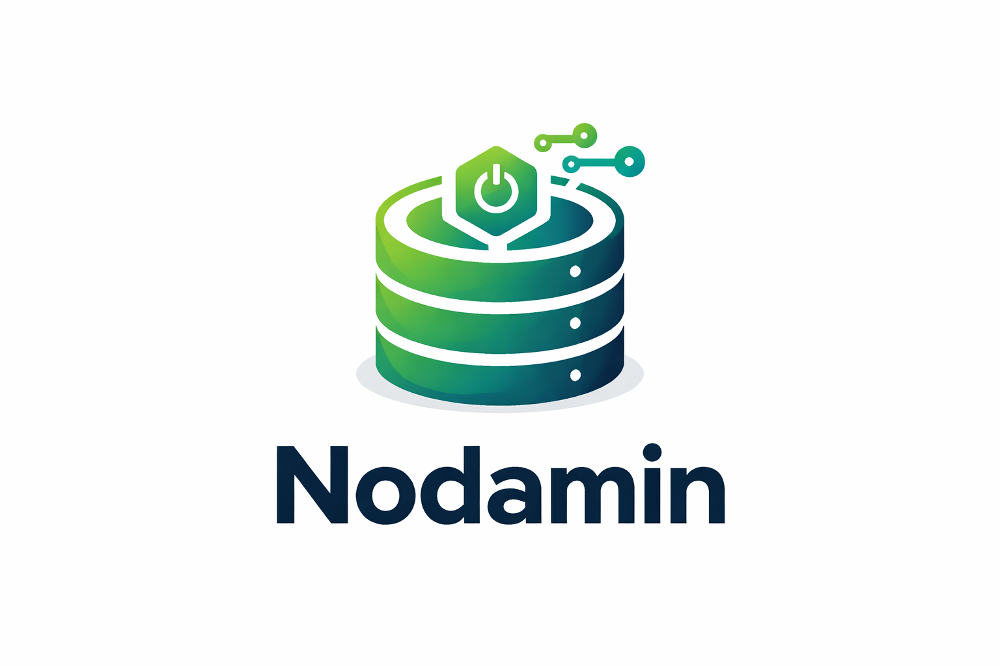

# ⚡ Nodamin



**Lightweight Database Admin for Node.js** — A single-process Adminer alternative powered by Node.js and TypeScript.

Nodamin is a web-based database administration tool inspired by [Adminer](https://www.adminer.org/). Built with Node.js and TypeScript, it is compiled into a highly portable package that requires zero external configuration to run.

## ✨ Features

- 🚀 **Zero Configuration** - Instantly run via `npx` with no setup required.
- 🔌 **Multiple SQL Database Support** - MySQL & SQLite available, with PostgreSQL planned.
- 🎨 **Simple & Clean UI** - Toggle between Light and Dark themes.
- ⚙️ **Custom Host & Port** - Configure binding ports and hosts via CLI or environment variables.
- 🔧 **Full CRUD Operations** - Insert, update, delete, truncate, and drop tables/rows.
- 📝 **SQL Query Editor** - Execute raw SQL with an interactive result viewer.
- 📊 **Table Browser** - Discover tables with pagination, sorting, and quick actions.
- 🔍 **Database Explorer** - Browse databases, tables, and structures easily.
- 📦 **Export/Import** - Export database/table to SQL dumps, or import existing SQL files.
- ✅ **Bulk Actions** - Select multiple tables/rows for bulk operations.
- 🔒 **SQL Safety Controls** - Optional read-only sessions, query timeout/cancellation, and typed
  confirmations for destructive actions.

## 🚀 Quick Start

The fastest and easiest way to use Nodamin is via `npx` (requires Node.js 20 or newer):

```bash
# Automatically download & run via npx
npx @dipras/nodamin

# Run with a custom port and host
npx @dipras/nodamin --port 8080 --host 127.0.0.1
```

Open your browser to the URL displayed in your terminal (default: `http://localhost:3088`) and connect to your MySQL or SQLite database.

<details>
<summary><b>🛠️ Install from Source (Manual)</b></summary>

```bash
# Clone repository
git clone https://github.com/dipras/nodamin.git
cd nodamin

# Install dependencies
npm install

# Build the distribution file
npm run build

# Run
npm start
```
</details>

📝 **Notes for SQLite**:
- You can upload an existing `.db` file directly via the UI.
- Selecting the **Create New** option will provision a temporary **In-Memory** database (data is lost upon server restart). This is perfect for quick testing and prototyping.
- SQLite runs synchronously in-process, so live query timeout and cancellation are only available
  for MySQL connections.

### Connection Safety

The connection form provides two optional safety controls:

- **Read-only mode** blocks CRUD, DDL, import, and mutating raw SQL. Uploaded SQLite databases are
  also opened with SQLite's native read-only flag.
- **Query timeout** sets the default limit for raw MySQL queries. The SQL editor keeps running
  queries attached to a query ID and exposes a Cancel button that interrupts the active MySQL query.

Dropping databases/tables, truncating tables, and deleting rows require typed confirmation. SQL
imports stop on the first MySQL error; SQLite imports use native script parsing and roll back the
script on failure unless the script explicitly manages its own transaction.

## 🛠️ Configuration & CLI Variables

Nodamin can be configured using CLI arguments or Environment Variables:

| CLI Argument | Environment Variable | Default | Description |
| :--- | :--- | :--- | :--- |
| `--port <number>` | `NODAMIN_PORT` | `3088` | Port for the web interface. |
| `--host <string>` | `NODAMIN_HOST` | `127.0.0.1` | IP Address/Host to bind the server to. Use `0.0.0.0` only on a trusted network or behind authentication. |

**Example using Environment Variables:**
```bash
NODAMIN_HOST=127.0.0.1 NODAMIN_PORT=9000 npx @dipras/nodamin
```

## 🛠️ Development

```bash
# Type check
npm run typecheck

# Build single file (production)
npm run build

# Development mode with watch
npm run dev
```

### Project Structure

```
src/
├── index.ts           # Entry point & CLI parser
├── server.ts          # HTTP server
├── router.ts          # Request router & body parser
├── routes.ts          # Route registration order only
├── routes/            # Route handlers grouped by domain
├── session.ts         # In-memory session lifecycle
├── types.ts           # TypeScript type definitions
├── db/
│   ├── driver.ts      # Shared database contract
│   ├── index.ts       # Per-session driver facade
│   ├── mysql.ts       # MySQL driver
│   └── sqlite.ts      # SQLite driver
└── views/
    ├── pages.ts       # View-model and rendering
    ├── templates/     # EJS source templates
    ├── styles.css     # Embedded stylesheet source
    └── scripts.js     # Embedded browser behavior
```

## 📋 Current MySQL Features

- ✅ Connect / Disconnect
- ✅ List databases
- ✅ Create / Drop database
- ✅ List tables with metadata (engine, rows, size, collation)
- ✅ View table structure (columns, types, keys, defaults)
- ✅ Browse table data with pagination & sorting
- ✅ Insert, Edit, Delete rows
- ✅ Drop & Truncate tables
- ✅ Raw SQL query editor with result display
- ✅ Create table with GUI (column types, constraints)
- ✅ Export table to SQL dump
- ✅ Export entire database to SQL dump
- ✅ Import SQL files
- ✅ Bulk actions for tables (drop, truncate, export multiple)
- ✅ Bulk delete for rows
- ✅ Light/Dark theme toggle with localStorage persistence
- ✅ Error handling with user-friendly messages

## 🗺️ Roadmap

Nodamin is focused on becoming a fast, reliable SQL database admin for local development and
trusted environments. The roadmap prioritizes a strong daily SQL workflow before adding more
database engines.

### 1. Reliability and SQL Safety

- [x] Expand integration tests for CRUD, pagination, sorting, import, and export
- [x] Add shared driver conformance tests for MySQL and SQLite
- [x] Improve SQL import parsing for quoted delimiters, triggers, and procedures
- [x] Add MySQL query timeout and cancellation controls
- [x] Add an optional read-only mode for safer database inspection
- [x] Improve destructive-action confirmations and import/error recovery

### 2. Daily Query Workflow

- [x] Save and switch between multiple connections for the current session
- [x] Connect with `mysql://` database URLs (PostgreSQL URLs follow PostgreSQL driver support)
- [x] Add query history, saved queries, and reusable snippets
- [x] Add SQL autocomplete for schemas, tables, columns, and keywords
- [x] Add keyboard shortcuts and a better query editor experience
- [x] Export query results and table data to CSV and JSON
- [x] Add table search and column-level data filters
- [x] Add `EXPLAIN` and query-plan viewing

### 3. Schema Management

- [ ] Alter tables from the UI: add, modify, rename, and drop columns
- [ ] Create, inspect, and drop indexes and unique constraints
- [ ] Inspect and manage foreign keys
- [ ] Add an ERD viewer based on foreign-key relationships
- [ ] Browse and manage views
- [ ] Browse triggers, stored procedures, and functions where supported

### 4. SQL Database Drivers

- [x] **MySQL** - Primary supported server database
- [x] **SQLite** - File-based and in-memory database support
- [ ] **PostgreSQL** - Next full driver, including schemas and PostgreSQL metadata
- [ ] **MariaDB** - Verify and document compatibility beyond the MySQL protocol
- [ ] **Microsoft SQL Server** - Later, after the shared SQL capabilities are stable

### 5. Administration and Deployment

- [ ] Inspect and manage database users, roles, and privileges where supported
- [ ] Add optional authentication for deployments outside localhost
- [ ] Add configurable session, cookie, proxy, and TLS security settings
- [ ] Add connection health, server information, and basic activity views
- [ ] Document safe localhost, trusted-network, and reverse-proxy deployment modes

## 📝 License

GPL-2.0 - Same as Adminer

## 🙏 Credits

Inspired by [Adminer](https://www.adminer.org/) by Jakub Vrána.

Built with Node.js, TypeScript, and ❤️
